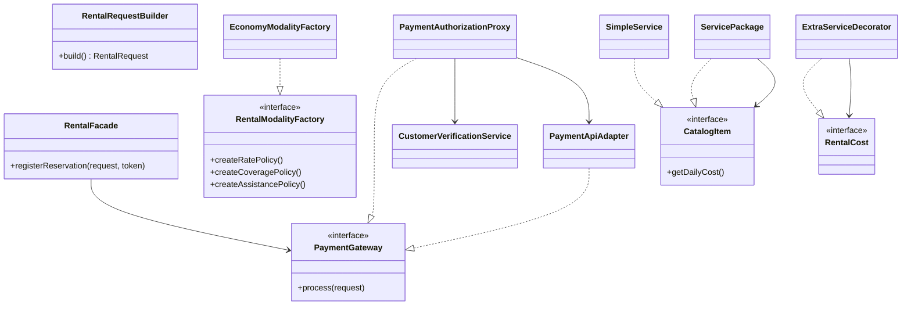

# RentCar — Parcial 2 de PGII

## 1. Integrantes

- Nombre completo — código estudiantil
- Nombre completo — código estudiantil
- Nombre completo — código estudiantil (si aplica)

## 2. Descripción de la solución

Aplicación de escritorio JavaFX para gestionar alquileres de vehículos en memoria. El usuario arma una solicitud, el sistema valida datos, disponibilidad, costo, autorización del cliente y pago externo, y deja registrada la reservación como `CONFIRMED` o `FAILED`.

## 3. Requisitos y funcionalidades implementadas

| Requisito | Qué hace la aplicación |
|---|---|
| RF-001 | `RentalRequestBuilder` arma la solicitud fuera de la vista y rechaza datos incompletos o fechas inválidas. |
| RF-002 | `RentalFacade` registra la reservación, valida disponibilidad, calcula el costo, procesa el pago y permite consultar el historial. |
| RF-003 | Modalidades Economy, Executive y Premium con Abstract Factory (tarifa, cobertura y asistencia). |
| RF-004 | `PaymentApiAdapter` habla con la API usando `PaymentApiClient`. |
| RF-005 | GPS, silla infantil y conductor extra se agregan con Decorator. |
| RF-006 | `PaymentAuthorizationProxy` consulta `CustomerVerificationService` y no llama a la API si el cliente no está autorizado. |
| RF-007 | Paquetes `Travel kit` y `Family pack` (paquete anidado) con Composite. |

## 4. Arquitectura y organización del código

MVC sencillo:

- **View:** FXML en `src/main/resources/edu/rentcar/view`
- **Controller:** `edu.rentcar.controller`
- **Model / domain:** `edu.rentcar.model`, `catalog`, `modality`, `pricing`, `payment`
- **Service / facade:** `edu.rentcar.service`, `edu.rentcar.facade`
- **Repository:** listas en memoria
- **App:** `ApplicationServices` comparte las mismas instancias entre pantallas

No hay base de datos. Al cerrar la aplicación se pierden los datos.

## 5. Patrones de diseño

| Patrón | Problema | Clases | Uso |
|---|---|---|---|
| Builder | Armar una solicitud válida por partes | `RentalRequestBuilder`, `RentalRequest` | Pantalla Reservations |
| Abstract Factory | Cada modalidad trae tarifa + cobertura + asistencia | `RentalModalityFactory` y fábricas Economy/Executive/Premium | `PricingService` |
| Facade | El alquiler combina varias reglas | `RentalFacade` | Controller de reservaciones |
| Adapter | El negocio no debe conocer el JSON/HTTP de la API | `PaymentApiAdapter` implementa `PaymentGateway` | Pago real |
| Decorator | Sumar extras al costo sin clases por combinación | `ExtraServiceDecorator` | Precio final |
| Proxy | Verificar al cliente antes de pagar | `PaymentAuthorizationProxy` | RF-006 |
| Composite | Tratar servicio y paquete igual, incluso paquetes anidados | `CatalogItem`, `SimpleService`, `ServicePackage` | Extras y paquetes |



## 6. Ejecución de la aplicación

### Requisitos

- JDK 21
- Conexión a Internet la primera vez que Gradle descargue dependencias

### API de pagos (obligatoria para un alquiler exitoso en la UI)

En una terminal, desde la raíz del proyecto:

```powershell
java -jar external\payment-api.jar
```

Debe quedar escuchando en `http://localhost:8080`.

### Ejecutar la app

```powershell
.\gradlew.bat run
```

### Ejecutar las pruebas

```powershell
.\gradlew.bat test
```

Las pruebas unitarias **no** necesitan la API: usan un `FakePaymentGateway`.

## 7. Integración de pagos

- Cliente HTTP del docente: `libs/payment-client.jar` (`PaymentApiClient`)
- URL: `http://localhost:8080`
- Tokens de prueba: `tok_approved`, `tok_declined`, `tok_api_error`
- Cliente autorizado de ejemplo: **Sofia Martinez** (`CUS-1001`)
- Cliente no autorizado: **Valentina Torres** (`CUS-1003`) — el proxy no llama a la API

Si la API no está encendida, el Adapter devuelve error de conexión y la reservación queda `FAILED`.

## 8. Pruebas realizadas

- `RentalRequestBuilderTest`: solicitud válida e inválida (RF-001)
- `RentalFacadeTest`: alquiler exitoso y fallidos (pago, disponibilidad, no autorizado) (RF-002)
- `PaymentAuthorizationProxyTest`: con/sin llamada al pago (RF-006)
- `ServicePackageTest`: paquete simple y anidado (RF-007)
- `PricingServiceTest` y `ModalityFactoryTest`: tarifa y extras
- `VehicleServiceTest`: registro de vehículos del starter

## 9. Limitaciones y decisiones de diseño

- Datos solo en memoria.
- El token de pago se elige en la UI para poder demostrar aprobación y rechazo.
- Las reservaciones fallidas también se guardan para poder consultarlas, pero no bloquean el vehículo.
- Una modalidad nueva se agrega con otra fábrica y un `case` en `ModalityFactoryProvider`, sin reescribir el Facade.
- Nombres de código en inglés; este README está en español.

## 10. Evidencias

- Código: este repositorio
- Documento técnico: este README (secciones 4 y 5) más el diagrama UML anterior
- Video: agregar enlace de YouTube aquí
